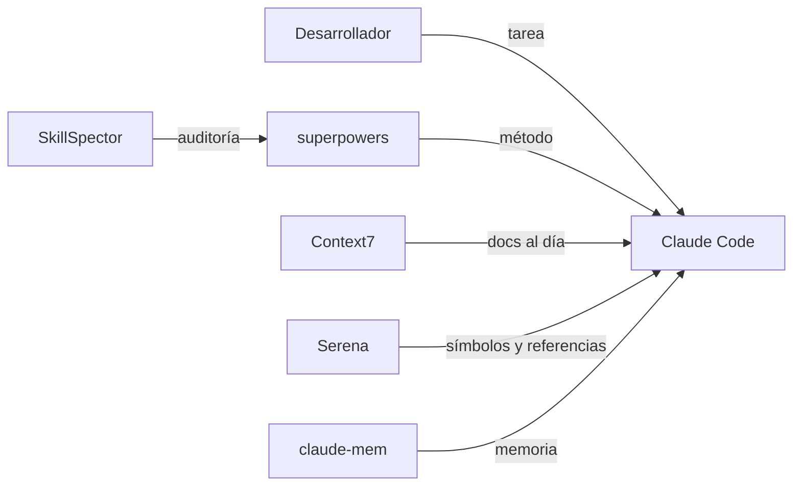

[🏠 Inicio](../README.md) · [🧪 Todas las recetas](README.md)

# 🛠️ Agente de código potenciado

> **Objetivo:** Sacar el máximo a Claude Code, Codex u opencode con método, contexto actualizado y memoria.

## 🗺️ Cómo fluye

## 🧩 Piezas

| # | Repo | Papel en la receta | ⭐ | Instalación |
|---:|---|---|---:|---|
| 1 | [Claude Code](../fichas/claude-code.md) | Agente de código en la terminal (o Codex / opencode) | 155k | `curl -fsSL https://claude.ai/install.sh \| bash` |
| 2 | [superpowers](../fichas/superpowers.md) | Metodología: planificar, probar y revisar antes de dar por hecho | 315k | `~/.claude/skills` |
| 3 | [Context7](../fichas/context7.md) | Documentación actualizada de librerías vía MCP | 64.5k | `npx -y @upstash/context7-mcp` |
| 4 | [Serena](../fichas/serena.md) | Búsqueda y edición semántica del código vía MCP | 31.3k | `uvx --from git+https://github.com/oraios/serena serena start-mcp-server` |
| 5 | [claude-mem](../fichas/claude-mem.md) | Memoria persistente entre sesiones | 116k | `/plugin marketplace add thedotmack/claude-mem` |
| 6 | [SkillSpector](../fichas/skillspector.md) | Audita skills de terceros antes de instalarlas | 25.2k | Clona el repo e instala sus dependencias (Python/Node) según el README; ejecútalo apunt… |

## 🔌 Cómo se conecta

Superpowers obliga al agente a planificar, escribir pruebas y revisar; Context7 le pasa la documentación vigente de cada librería; Serena le da navegación semántica del código en lugar de leer archivos enteros; claude-mem conserva decisiones entre sesiones. SkillSpector revisa cualquier skill nueva antes de instalarla.

## 🚫 Cuándo NO usar esta receta

Si solo haces cambios pequeños y puntuales, el agente tal cual basta: cada pieza añade contexto y configuración.

## 🔁 Variantes

- En lugar de [Claude Code](../fichas/claude-code.md): [Codex CLI](../fichas/codex.md), [Gemini CLI](../fichas/gemini-cli.md), [OpenCode](../fichas/opencode.md)
- En lugar de [superpowers](../fichas/superpowers.md): [Agent Skills (Addy Osmani)](../fichas/agent-skills.md)
- En lugar de [Context7](../fichas/context7.md): [DeepWiki Open](../fichas/deepwiki-open.md)
- En lugar de [Serena](../fichas/serena.md): [codegraph](../fichas/codegraph.md), [GitNexus](../fichas/gitnexus.md)
- En lugar de [claude-mem](../fichas/claude-mem.md): [Engram](../fichas/engram.md), [agentmemory](../fichas/agentmemory.md)

---

Generado por `uv run repo-intelligence guide build` desde `INDICE_IA.json` + `INDICE_IA.detalle.json`. No edites este archivo a mano. Datos de GitHub verificados el 2026-11-05.
