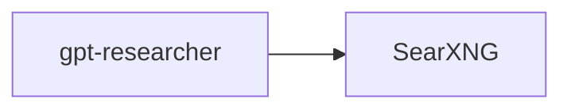

[🏠 Inicio](../README.md) · [🧪 Todas las recetas](README.md)

# 🔎 Agente de research profundo

> **Objetivo:** Investigar un tema en la web y entregar un informe estructurado con fuentes citadas.

## Empieza con una versión pequeña

Propuesta editorial; no es una integración ejecutada ni una lista completa de dependencias.

**Piezas iniciales:** [gpt-researcher](../fichas/gpt-researcher.md), [SearXNG](../fichas/searxng.md)

**Prepara:** Una pregunta acotada que puedas contrastar

**Primera prueba propuesta:** Genera un informe breve y abre tres de sus fuentes

**Qué comprobar:** Las fuentes existen y respaldan las afirmaciones del informe

Comprueba el proveedor de modelo y búsqueda; una cita no garantiza que la conclusión sea correcta

## Orden propuesto para preparar las piezas

## 🧩 Piezas

| # | Repo | Papel en la receta | ⭐ | Instalación |
|---:|---|---|---:|---|
| 1 | [gpt-researcher](../fichas/gpt-researcher.md) | Orquestador: planifica preguntas, delega y redacta el informe | 30.7k | Abre la guía original enlazada y elige tu sistema y la ruta de aplicación,plugin o códi… |
| 2 | [SearXNG](../fichas/searxng.md) | Buscador privado y sin claves de API | 39.6k | Ver README oficial (sin comando literal documentado). Abre la guía original enlazada y… |
| 3 | [crawl4ai](../fichas/crawl4ai.md) | Convierte cada página en Markdown limpio para el LLM | 87.4k | Abre las instrucciones originales enlazadas y elige tu sistema operativo y una sola rut… |
| 4 | [browser-use](../fichas/browser-use.md) | Navega sitios dinámicos o con login | 121k | Abre la guía original enlazada y elige tu sistema y la ruta de aplicación,plugin o códi… |
| 5 | [markitdown](../fichas/markitdown.md) | Ingiere PDFs y documentos locales | 195k | `pip install 'markitdown[all]'` |
| 6 | [langfuse](../fichas/langfuse.md) | Trazas, costos y depuración de cada paso | 37.4k | Abre las instrucciones originales enlazadas y elige tu sistema operativo y una sola rut… |

## 🔌 Cómo se conecta

GPT Researcher divide la pregunta en sub-preguntas, busca con SearXNG y pasa las URLs a Crawl4AI, que devuelve Markdown listo para el modelo. Browser Use cubre las páginas que necesitan clics o sesión, y MarkItDown suma tus documentos. Langfuse registra cada llamada para revisar costos y errores. DeerFlow es la alternativa si prefieres un harness con sandbox y más autonomía.

## 🚫 Cuándo NO usar esta receta

Si la investigación es solo sobre documentos internos, no necesitas buscador ni crawler: usa la receta de RAG sobre documentos.

## 🔁 Variantes

- En lugar de [gpt-researcher](../fichas/gpt-researcher.md): [STORM](../fichas/storm.md), [Vane](../fichas/vane.md), [local-deep-research](../fichas/local-deep-research.md)
- En lugar de [crawl4ai](../fichas/crawl4ai.md): [Jina Reader](../fichas/jina-reader.md)
- En lugar de [browser-use](../fichas/browser-use.md): [Gemini Computer Use (preview)](../fichas/computer-use-preview.md), [Stagehand](../fichas/stagehand.md), [Skyvern](../fichas/skyvern.md)
- En lugar de [langfuse](../fichas/langfuse.md): [Phoenix](../fichas/phoenix.md), [Opik](../fichas/opik.md), [MLflow](../fichas/mlflow.md)

---

Generado por `uv run repo-intelligence guide build` desde `INDICE_IA.json` + `INDICE_IA.detalle.json`. No edites este archivo a mano. Datos de GitHub verificados el 2026-11-14.
