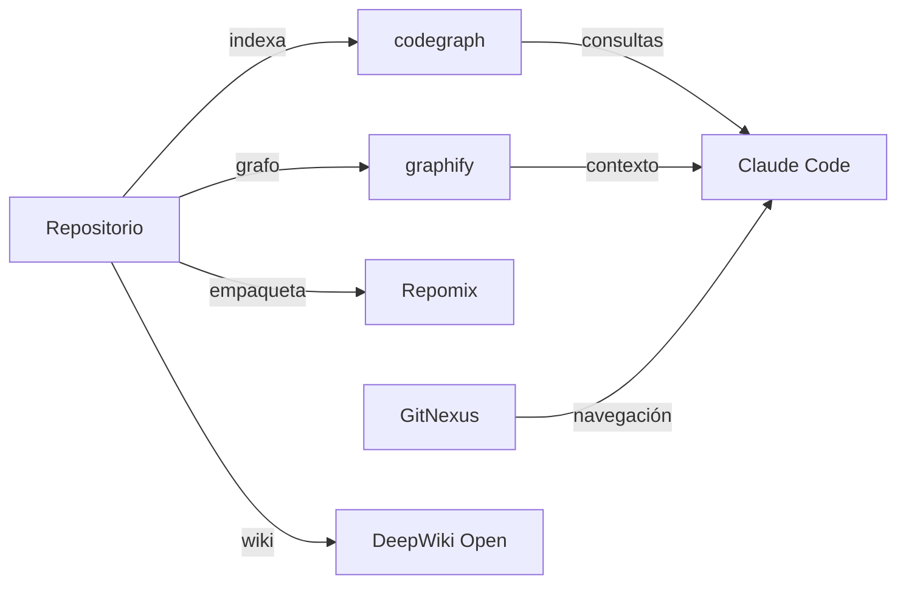

[🏠 Inicio](../README.md) · [🧪 Todas las recetas](README.md)

# 🧠 Análisis de repos grandes

> **Objetivo:** Que un agente de código entienda una base de código enorme sin gastar todo su contexto.

## 🗺️ Cómo fluye

## 🧩 Piezas

| # | Repo | Papel en la receta | ⭐ | Instalación |
|---:|---|---|---:|---|
| 1 | [Repomix](../fichas/repomix.md) | Empaqueta el repo (o una parte) en un archivo para el LLM | 29.2k | `npx repomix` |
| 2 | [codegraph](../fichas/codegraph.md) | Grafo de código pre-indexado que se sincroniza con los cambios | 77.3k | `npm install -g codegraph` |
| 3 | [GitNexus](../fichas/gitnexus.md) | Explora dependencias y flujos sin servidor | 48.4k | `git clone https://github.com/abhigyanpatwari/GitNexus` |
| 4 | [graphify](../fichas/graphify.md) | Grafo de conocimiento con código, docs y esquemas | 145k | `pipx install graphify` |
| 5 | [DeepWiki Open](../fichas/deepwiki-open.md) | Genera una wiki navegable del repositorio | 18.4k | `docker compose up` |
| 6 | [Claude Code](../fichas/claude-code.md) | Agente que consulta los índices y edita el código | 155k | `curl -fsSL https://claude.ai/install.sh \| bash` |

## 🔌 Cómo se conecta

CodeGraph y graphify construyen índices estructurales que el agente consulta en lugar de leer archivos completos; GitNexus ayuda a recorrer dependencias; Repomix empaqueta solo la parte relevante cuando necesitas pasar código a un chat. DeepWiki Open produce documentación para humanos. Claude Code (o Codex) usa todo eso como contexto barato.

## 🚫 Cuándo NO usar esta receta

Si el repo es pequeño (menos de unas 10.000 líneas), el agente de código con referencias directas a archivos basta.

## 🔁 Variantes

- En lugar de [Repomix](../fichas/repomix.md): [GitNexus](../fichas/gitnexus.md)
- En lugar de [codegraph](../fichas/codegraph.md): [codebase-memory-mcp](../fichas/codebase-memory-mcp.md), [Serena](../fichas/serena.md)
- En lugar de [GitNexus](../fichas/gitnexus.md): [Repomix](../fichas/repomix.md), [codebase-memory-mcp](../fichas/codebase-memory-mcp.md), [Serena](../fichas/serena.md)
- En lugar de [DeepWiki Open](../fichas/deepwiki-open.md): [Context7](../fichas/context7.md)
- En lugar de [Claude Code](../fichas/claude-code.md): [Codex CLI](../fichas/codex.md), [Gemini CLI](../fichas/gemini-cli.md), [OpenCode](../fichas/opencode.md)

---

Generado por `uv run repo-intelligence guide build` desde `INDICE_IA.json` + `INDICE_IA.detalle.json`. No edites este archivo a mano. Datos de GitHub verificados el 2026-11-05.
