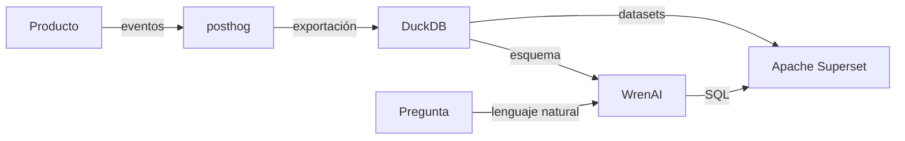

[🏠 Inicio](../README.md) · [🧪 Todas las recetas](README.md)

# 📊 Analítica de producto con IA

> **Objetivo:** Medir el uso de tu producto y responder preguntas de negocio en lenguaje natural.

## 🗺️ Cómo fluye

## 🧩 Piezas

| # | Repo | Papel en la receta | ⭐ | Instalación |
|---:|---|---|---:|---|
| 1 | [posthog](../fichas/posthog.md) | Eventos, embudos, grabaciones y feature flags | 40.7k | `docker compose` |
| 2 | [DuckDB](../fichas/duckdb.md) | Análisis SQL rápido sobre exportaciones o Parquet | 43k | `pip install duckdb` |
| 3 | [WrenAI](../fichas/wrenai.md) | Preguntas en lenguaje natural convertidas a SQL | 18.1k | Descarga el lanzador de releases o usa Docker Compose del repo. |
| 4 | [Apache Superset](../fichas/superset.md) | Dashboards y exploración para todo el equipo | 75.5k | `git clone https://github.com/apache/superset && cd superset && docker compose -f docker-compose-image-tag.yml up` |
| 5 | [Umami](../fichas/umami.md) | Alternativa ligera para analítica web sin cookies | 40k | `docker compose up -d` |

## 🔌 Cómo se conecta

PostHog captura eventos y embudos; exportas a Parquet y analizas con DuckDB sin montar un warehouse; WrenAI traduce preguntas a SQL sobre tu esquema; Superset publica los dashboards. Si solo necesitas visitas y fuentes de tráfico, Umami o Plausible bastan.

## 🚫 Cuándo NO usar esta receta

Si tu producto aún tiene poco tráfico, empieza solo con PostHog o Umami: el resto añade operación sin aportar todavía.

## 🔁 Variantes

- En lugar de [DuckDB](../fichas/duckdb.md): [Polars](../fichas/polars.md)
- En lugar de [WrenAI](../fichas/wrenai.md): [PandasAI](../fichas/pandas-ai.md)
- En lugar de [Apache Superset](../fichas/superset.md): [metabase](../fichas/metabase.md), [Redash](../fichas/redash.md)
- En lugar de [Umami](../fichas/umami.md): [Plausible Analytics](../fichas/plausible.md), [Matomo](../fichas/matomo.md)

---

Generado por `uv run repo-intelligence guide build` desde `INDICE_IA.json` + `INDICE_IA.detalle.json`. No edites este archivo a mano. Datos de GitHub verificados el 2026-11-05.
