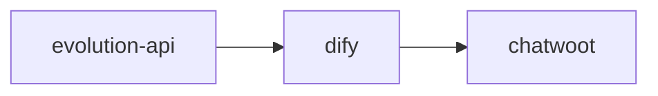

[🏠 Inicio](../README.md) · [🧪 Todas las recetas](README.md)

# 💬 Bot de WhatsApp con IA

> **Objetivo:** Atender y vender por WhatsApp con un agente LLM que guarda leads y pasa la conversación a una persona cuando hace falta.

## Empieza con una versión pequeña

Propuesta editorial; no es una integración ejecutada ni una lista completa de dependencias.

**Piezas iniciales:** [evolution-api](../fichas/evolution-api.md), [dify](../fichas/dify.md), [chatwoot](../fichas/chatwoot.md)

**Prepara:** Un mensaje enviado desde un número de prueba

**Primera prueba propuesta:** Recibe el mensaje, envíalo al flujo y pide pasar con una persona

**Qué comprobar:** El mensaje llega a la bandeja y puedes responder manualmente

Decide primero la conexión del canal, sus políticas y posibles tarifas; Dify y Evolution se conectan por su integración nativa, sin flujos intermedios

## Orden propuesto para preparar las piezas

## 🧩 Piezas

| # | Repo | Papel en la receta | ⭐ | Instalación |
|---:|---|---|---:|---|
| 1 | [evolution-api](../fichas/evolution-api.md) | Canal de WhatsApp: recibe y envía mensajes; integra Dify y Chatwoot de forma nativa | 10.1k | Abre la guía original enlazada y elige tu sistema y la ruta de aplicación,plugin o códi… |
| 2 | [dify](../fichas/dify.md) | Agente o flujo con LLM: responde, guarda el lead y decide el traspaso | 161k | Abre la guía original enlazada y elige tu sistema y la ruta de aplicación,plugin o códi… |
| 3 | [chatwoot](../fichas/chatwoot.md) | Bandeja omnicanal para el traspaso a un agente humano | 39.9k | Abre la guía original enlazada y elige tu sistema y la ruta de aplicación,plugin o códi… |
| 4 | [novu](../fichas/novu.md) | Notificaciones internas (email, push) cuando entra un lead | 40.3k | Abre la guía original enlazada y elige tu sistema y la ruta de aplicación,plugin o códi… |

## 🔌 Cómo se conecta

Evolution API mantiene la sesión de WhatsApp y, mediante su integración nativa con Dify, pasa cada mensaje a una app de Dify (agente o chatflow) que arma el contexto, llama al LLM y guarda el lead. La integración nativa de Evolution con Chatwoot lleva las conversaciones a la bandeja para que responda una persona cuando hace falta. Novu avisa al equipo cuando Dify detecta un lead (por ejemplo, con una herramienta HTTP).

## 🚫 Cuándo NO usar esta receta

Si solo necesitas respuestas automáticas simples sin traspaso a humano, basta con Evolution API (o WAHA) y un webhook propio. Si no quieres operar servidores, usa la API oficial de WhatsApp Business con un proveedor gestionado.

## 🔁 Variantes

- En lugar de [evolution-api](../fichas/evolution-api.md): [whatsapp-web.js](../fichas/whatsapp-web-js.md), [WAHA](../fichas/waha.md)
- En lugar de [dify](../fichas/dify.md): [Sim](../fichas/sim.md), [RAGFlow](../fichas/ragflow.md)

---

Generado por `uv run repo-intelligence guide build` desde `INDICE_IA.json` + `INDICE_IA.detalle.json`. No edites este archivo a mano. Datos de GitHub verificados el 2026-11-14.
