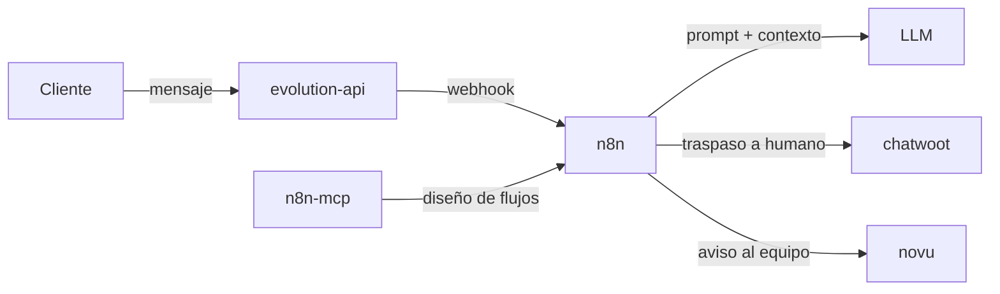

[🏠 Inicio](../README.md) · [🧪 Todas las recetas](README.md)

# 💬 Bot de WhatsApp con IA

> **Objetivo:** Atender y vender por WhatsApp con un agente LLM que guarda leads y pasa la conversación a una persona cuando hace falta.

## 🗺️ Cómo fluye

## 🧩 Piezas

| # | Repo | Papel en la receta | ⭐ | Instalación |
|---:|---|---|---:|---|
| 1 | [evolution-api](../fichas/evolution-api.md) | Canal de WhatsApp: recibe y envía mensajes por webhook | 10.1k | `docker compose` |
| 2 | [n8n](../fichas/n8n.md) | Orquesta el flujo: llama al LLM, guarda el lead y decide el traspaso | 210k | `docker compose` |
| 3 | [n8n-mcp](../fichas/n8n-mcp.md) | Le da a tu agente de código el contexto de los nodos de n8n | 23.2k | `npx n8n-mcp` |
| 4 | [n8n-skills](../fichas/n8n-skills.md) | Skills para que Claude Code diseñe los workflows sin errores | 6.6k | Clona el repo y copia las skills (`SKILL.md`) a tu directorio de skills de Claude Code… |
| 5 | [chatwoot](../fichas/chatwoot.md) | Bandeja omnicanal para el traspaso a un agente humano | 39.5k | `docker compose` |
| 6 | [novu](../fichas/novu.md) | Notificaciones internas (email, push) cuando entra un lead | 40.3k | `docker compose` |

## 🔌 Cómo se conecta

Evolution API mantiene la sesión de WhatsApp y reenvía cada mensaje a un webhook de n8n. El workflow de n8n arma el contexto, llama al LLM, guarda el lead y, si detecta una intención de compra o un problema, abre la conversación en Chatwoot para que responda una persona. Novu avisa al equipo. Con n8n-mcp y n8n-skills, tu agente de código construye y corrige esos workflows por ti.

## 🚫 Cuándo NO usar esta receta

Si solo necesitas respuestas automáticas simples sin traspaso a humano, basta con Evolution API (o WAHA) y un webhook propio. Si no quieres operar servidores, usa la API oficial de WhatsApp Business con un proveedor gestionado.

## 🔁 Variantes

- En lugar de [evolution-api](../fichas/evolution-api.md): [whatsapp-web.js](../fichas/whatsapp-web-js.md), [WAHA](../fichas/waha.md)
- En lugar de [n8n](../fichas/n8n.md): [activepieces](../fichas/activepieces.md), [huginn](../fichas/huginn.md), [Windmill](../fichas/windmill.md)

---

Generado por `uv run repo-intelligence guide build` desde `INDICE_IA.json` + `INDICE_IA.detalle.json`. No edites este archivo a mano. Datos de GitHub verificados el 2026-11-05.
