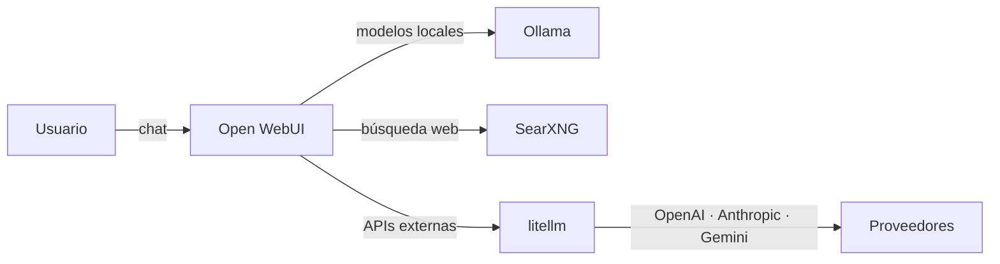

[🏠 Inicio](../README.md) · [🧪 Todas las recetas](README.md)

# 🦙 ChatGPT privado con modelos locales

> **Objetivo:** Tener un chat tipo ChatGPT para ti o tu equipo con modelos que corren en tu máquina o servidor.

## 🗺️ Cómo fluye

## 🧩 Piezas

| # | Repo | Papel en la receta | ⭐ | Instalación |
|---:|---|---|---:|---|
| 1 | [Ollama](../fichas/ollama.md) | Descarga y sirve los modelos con una API local | 187k | `curl -fsSL https://ollama.com/install.sh \| sh` |
| 2 | [Open WebUI](../fichas/open-webui.md) | Interfaz web con usuarios, RAG, voz y herramientas | 158k | `docker run -d -p 3000:8080 -v open-webui:/app/backend/data ghcr.io/open-webui/open-webui:main` |
| 3 | [SearXNG](../fichas/searxng.md) | Búsqueda web privada para respuestas actualizadas | 39.4k | `docker run -d -p 8080:8080 searxng/searxng` |
| 4 | [litellm](../fichas/litellm.md) | Gateway opcional para mezclar modelos locales y APIs comerciales | 63k | `pip install litellm` |

## 🔌 Cómo se conecta

Ollama corre los modelos y expone una API compatible con OpenAI; Open WebUI se conecta a ella y añade cuentas de usuario, subida de documentos, búsqueda web vía SearXNG y herramientas. Si algunos usuarios necesitan modelos comerciales, LiteLLM unifica el acceso con control de costos.

## 🚫 Cuándo NO usar esta receta

Si es solo para ti en tu portátil, una app de escritorio como Jan o LM Studio es más simple. Si tu hardware no corre modelos medianos, usa directamente una API.

## 🔁 Variantes

- En lugar de [Ollama](../fichas/ollama.md): [llama.cpp](../fichas/llama-cpp.md), [LocalAI](../fichas/localai.md), [llamafile](../fichas/llamafile.md)
- En lugar de [Open WebUI](../fichas/open-webui.md): [LibreChat](../fichas/librechat.md), [LobeHub](../fichas/lobehub.md), [AnythingLLM](../fichas/anything-llm.md)

---

Generado por `uv run repo-intelligence guide build` desde `INDICE_IA.json` + `INDICE_IA.detalle.json`. No edites este archivo a mano. Datos de GitHub verificados el 2026-11-05.
