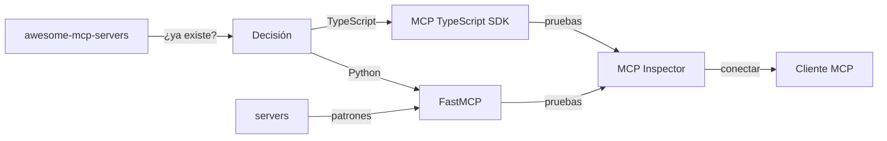

[🏠 Inicio](../README.md) · [🧪 Todas las recetas](README.md)

# 🔌 Construir una app o servidor MCP

> **Objetivo:** Exponer tus datos o herramientas a Claude, ChatGPT, Cursor y otros agentes con Model Context Protocol.

## 🗺️ Cómo fluye

## 🧩 Piezas

| # | Repo | Papel en la receta | ⭐ | Instalación |
|---:|---|---|---:|---|
| 1 | [awesome-mcp-servers](../fichas/awesome-mcp-servers.md) | Comprueba primero si ya existe un servidor para tu caso | 97.6k | `npx` |
| 2 | [FastMCP](../fichas/fastmcp.md) | Framework Python para escribir el servidor en pocas líneas | 28.4k | `pip install fastmcp` |
| 3 | [MCP TypeScript SDK](../fichas/mcp-typescript-sdk.md) | SDK oficial si tu servidor es TypeScript | 13.7k | `npm install @modelcontextprotocol/sdk` |
| 4 | [MCP Inspector](../fichas/mcp-inspector.md) | Prueba y depura el servidor antes de conectarlo | 11.3k | `npx @modelcontextprotocol/inspector` |
| 5 | [servers](../fichas/servers.md) | Implementaciones de referencia para copiar patrones | 91.9k | `npx` |
| 6 | [mcp-use](../fichas/mcp-use.md) | Apps MCP y clientes full-stack cuando necesitas UI | 10.9k | `npm install mcp-use` |

## 🔌 Cómo se conecta

Busca en awesome-mcp-servers antes de construir. Si no existe, FastMCP (Python) o el SDK oficial de TypeScript te dan el servidor con poco código; los servidores de referencia muestran cómo modelar tools, recursos y prompts. MCP Inspector valida el servidor antes de conectarlo a Claude Code, Codex o Cursor. mcp-use sirve cuando quieres una app MCP con interfaz propia.

## 🚫 Cuándo NO usar esta receta

Si solo vas a consumir un servidor que ya existe, no construyas uno: instálalo desde su README.

## 🔁 Variantes

- En lugar de [FastMCP](../fichas/fastmcp.md): [MCP Python SDK](../fichas/mcp-python-sdk.md)
- En lugar de [MCP TypeScript SDK](../fichas/mcp-typescript-sdk.md): [mcp-use](../fichas/mcp-use.md)
- En lugar de [mcp-use](../fichas/mcp-use.md): [LangChain MCP Adapters](../fichas/langchain-mcp-adapters.md), [MCP TypeScript SDK](../fichas/mcp-typescript-sdk.md)

---

Generado por `uv run repo-intelligence guide build` desde `INDICE_IA.json` + `INDICE_IA.detalle.json`. No edites este archivo a mano. Datos de GitHub verificados el 2026-11-05.
