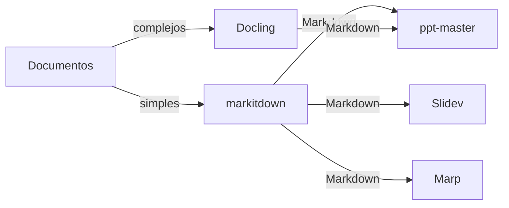

[🏠 Inicio](../README.md) · [🧪 Todas las recetas](README.md)

# 📊 Documentos → presentaciones

> **Objetivo:** Pasar informes, PDFs o notas a presentaciones editables o slides web.

## 🗺️ Cómo fluye

## 🧩 Piezas

| # | Repo | Papel en la receta | ⭐ | Instalación |
|---:|---|---|---:|---|
| 1 | [markitdown](../fichas/markitdown.md) | Convierte Office, HTML y PDF simples a Markdown | 195k | `pip install markitdown` |
| 2 | [Docling](../fichas/docling.md) | Para PDFs complejos: tablas, layout y OCR | 70.4k | `pip install docling` |
| 3 | [ppt-master](../fichas/ppt-master.md) | Genera PowerPoint nativo y editable con IA | 75.5k | `git clone` |
| 4 | [Slidev](../fichas/slidev.md) | Slides web desde Markdown para presentaciones técnicas | 49.4k | `npm init slidev@latest` |
| 5 | [Marp](../fichas/marp.md) | Markdown → PDF/PPTX con una sintaxis mínima | 12.7k | `npm i -g @marp-team/marp-cli` |

## 🔌 Cómo se conecta

MarkItDown (o Docling si el PDF tiene tablas y columnas) normaliza todo a Markdown. Desde ahí, PPT Master genera un PowerPoint nativo editable, Slidev produce slides web con código y componentes, y Marp exporta a PDF o PPTX con estilos simples.

## 🚫 Cuándo NO usar esta receta

Si el contenido ya está en Markdown, salta la conversión. Si necesitas un diseño de marca al píxel, una herramienta de diseño dedicada da más control.

## 🔁 Variantes

- En lugar de [Docling](../fichas/docling.md): [Marker](../fichas/marker.md), [MinerU](../fichas/mineru.md), [Unstructured](../fichas/unstructured.md)
- En lugar de [ppt-master](../fichas/ppt-master.md): [Presenton](../fichas/presenton.md)
- En lugar de [Slidev](../fichas/slidev.md): [Marp](../fichas/marp.md), [reveal.js](../fichas/reveal-js.md)
- En lugar de [Marp](../fichas/marp.md): [Slidev](../fichas/slidev.md), [reveal.js](../fichas/reveal-js.md)

---

Generado por `uv run repo-intelligence guide build` desde `INDICE_IA.json` + `INDICE_IA.detalle.json`. No edites este archivo a mano. Datos de GitHub verificados el 2026-11-05.
