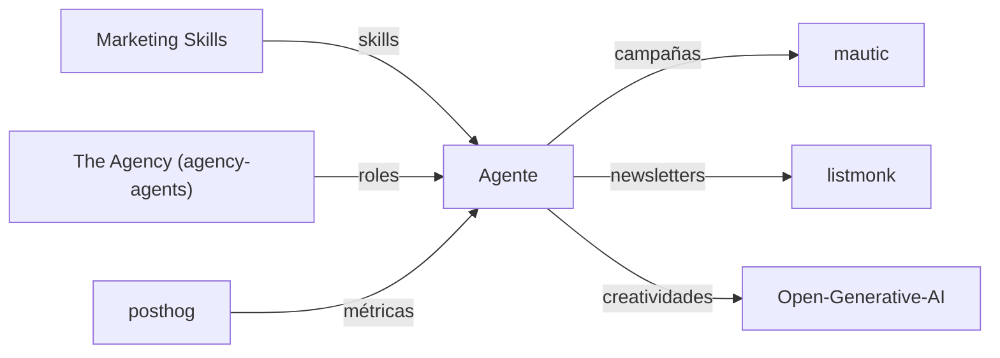

[🏠 Inicio](../README.md) · [🧪 Todas las recetas](README.md)

# 📈 Marketing de agencia

> **Objetivo:** Operar campañas, contenido y email a escala con agentes y herramientas propias.

## 🗺️ Cómo fluye

## 🧩 Piezas

| # | Repo | Papel en la receta | ⭐ | Instalación |
|---:|---|---|---:|---|
| 1 | [Marketing Skills](../fichas/marketingskills.md) | Skills de CRO, copy, SEO y analítica para tu agente | 59.5k | `npx skills add coreyhaines31/marketingskills` |
| 2 | [The Agency (agency-agents)](../fichas/agency-agents.md) | Roles de agencia listos (estratega, redactor, analista…) | 168k | `git clone https://github.com/msitarzewski/agency-agents && cd agency-agents && ./scripts/install.sh --tool claude-code --division engineering,marketing` |
| 3 | [mautic](../fichas/mautic.md) | Automatización de marketing: segmentos, scoring y nurturing | 11k | `docker compose` |
| 4 | [listmonk](../fichas/listmonk.md) | Newsletters y envíos masivos baratos | 24.2k | `docker compose` |
| 5 | [posthog](../fichas/posthog.md) | Analítica de producto y embudos | 40.7k | `docker compose` |
| 6 | [Open-Generative-AI](../fichas/open-generative-ai.md) | Creatividades de imagen y video | 33.8k | `git clone` |

## 🔌 Cómo se conecta

Las skills y los roles guían a tu agente de código en cada canal; Mautic segmenta y nutre leads; listmonk envía newsletters; PostHog mide conversión y retención; Open Generative AI produce piezas visuales. Metabase o Superset sirven si necesitas reportes para clientes.

## 🚫 Cuándo NO usar esta receta

Si gestionas una sola marca pequeña, Mautic es excesivo: listmonk y una hoja de cálculo bastan.

## 🔁 Variantes

- En lugar de [The Agency (agency-agents)](../fichas/agency-agents.md): [wshobson/agents](../fichas/wshobson-agents.md)

---

Generado por `uv run repo-intelligence guide build` desde `INDICE_IA.json` + `INDICE_IA.detalle.json`. No edites este archivo a mano. Datos de GitHub verificados el 2026-11-05.
