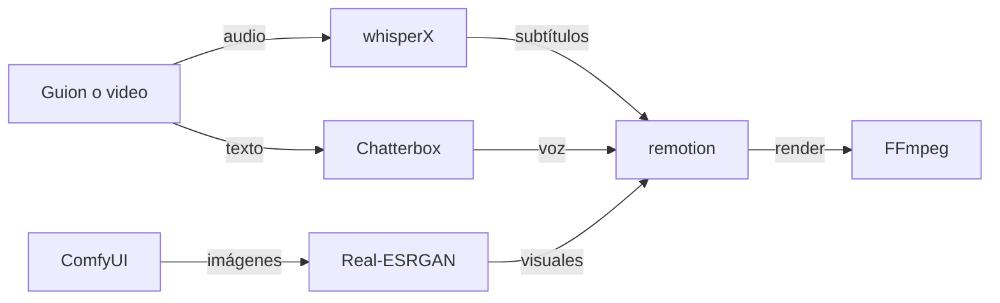

[🏠 Inicio](../README.md) · [🧪 Todas las recetas](README.md)

# 🎬 Pipeline de Reels / video corto

> **Objetivo:** Convertir un guion o un video largo en clips verticales con voz, subtítulos y visuales generados.

## 🗺️ Cómo fluye

## 🧩 Piezas

| # | Repo | Papel en la receta | ⭐ | Instalación |
|---:|---|---|---:|---|
| 1 | [whisperX](../fichas/whisperx.md) | Transcribe y alinea palabra por palabra para los subtítulos | 25.2k | `pip install whisperx` |
| 2 | [Chatterbox](../fichas/chatterbox.md) | Genera la voz en off (o clona una voz con consentimiento) | 27.7k | `pip install chatterbox-tts` |
| 3 | [ComfyUI](../fichas/comfyui.md) | Genera imágenes o b-roll con modelos de difusión | 146k | `git clone` |
| 4 | [Real-ESRGAN](../fichas/real-esrgan.md) | Escala y limpia las imágenes antes del montaje | 37.4k | `pip install realesrgan` |
| 5 | [remotion](../fichas/remotion.md) | Ensambla el video con plantillas en React | 72.2k | `npm create video` |
| 6 | [FFmpeg](../fichas/ffmpeg.md) | Render final, formatos y compresión | 66.9k | `brew install ffmpeg` |
| 7 | [MoneyPrinterTurbo](../fichas/moneyprinterturbo.md) | Atajo todo-en-uno: tema → video corto automático | 142k | `pip install mpt` |

## 🔌 Cómo se conecta

WhisperX saca los subtítulos con marcas de tiempo por palabra; Chatterbox genera la locución; ComfyUI produce los visuales y Real-ESRGAN los mejora. Remotion arma el clip con una plantilla reutilizable y FFmpeg exporta el formato final. Si quieres algo inmediato sin montar piezas, MoneyPrinterTurbo hace el recorrido completo desde un tema.

## 🚫 Cuándo NO usar esta receta

Si no tienes GPU, usa APIs de generación de imagen y voz en la nube en lugar de ComfyUI y Chatterbox. Si solo necesitas cortar y subtitular un video existente, WhisperX más LosslessCut bastan.

## 🔁 Variantes

- En lugar de [whisperX](../fichas/whisperx.md): [NVIDIA NeMo Speech](../fichas/nemo.md)
- En lugar de [Chatterbox](../fichas/chatterbox.md): [Fish Speech](../fichas/fish-speech.md), [GPT-SoVITS](../fichas/gpt-sovits.md), [Kokoro](../fichas/kokoro.md)
- En lugar de [ComfyUI](../fichas/comfyui.md): [WanGP](../fichas/wan2gp.md), [Stable Diffusion WebUI Forge](../fichas/sd-webui-forge.md)
- En lugar de [remotion](../fichas/remotion.md): [MoviePy](../fichas/moviepy.md), [HyperFrames](../fichas/hyperframes.md)
- En lugar de [MoneyPrinterTurbo](../fichas/moneyprinterturbo.md): [OpenMontage](../fichas/openmontage.md), [videofy_minimal](../fichas/videofy-minimal.md)

---

Generado por `uv run repo-intelligence guide build` desde `INDICE_IA.json` + `INDICE_IA.detalle.json`. No edites este archivo a mano. Datos de GitHub verificados el 2026-11-05.
