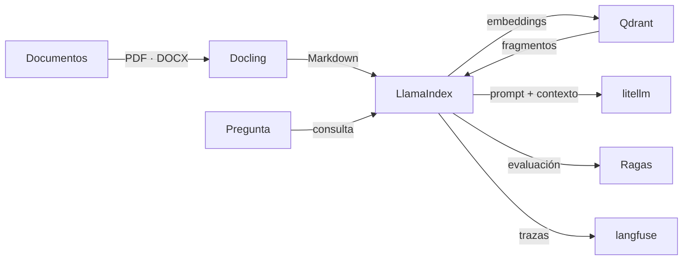

[🏠 Inicio](../README.md) · [🧪 Todas las recetas](README.md)

# 📎 RAG sobre tus documentos

> **Objetivo:** Preguntarle a tus PDFs, manuales y bases de conocimiento con respuestas citadas.

## 🗺️ Cómo fluye

## 🧩 Piezas

| # | Repo | Papel en la receta | ⭐ | Instalación |
|---:|---|---|---:|---|
| 1 | [Docling](../fichas/docling.md) | Extrae texto, tablas y estructura de los documentos | 70.4k | `pip install docling` |
| 2 | [LlamaIndex](../fichas/llama-index.md) | Fragmenta, indexa y recupera; orquesta las consultas | 52.9k | `pip install llama-index` |
| 3 | [Qdrant](../fichas/qdrant.md) | Base vectorial para los embeddings | 35.5k | `docker run -p 6333:6333 qdrant/qdrant` |
| 4 | [litellm](../fichas/litellm.md) | Acceso unificado al LLM (local o en la nube) | 63k | `pip install litellm` |
| 5 | [Ragas](../fichas/ragas.md) | Evalúa la calidad de recuperación y respuesta | 16.3k | `pip install ragas` |
| 6 | [langfuse](../fichas/langfuse.md) | Trazas y costos en producción | 37.3k | `pip` |

## 🔌 Cómo se conecta

Docling convierte los documentos en Markdown estructurado; LlamaIndex los fragmenta, genera embeddings y los guarda en Qdrant; en cada pregunta recupera los fragmentos relevantes y llama al modelo vía LiteLLM. Ragas mide si la respuesta usa bien el contexto y Langfuse registra cada consulta. Si prefieres una plataforma con UI, RAGFlow o AnythingLLM cubren el flujo completo.

## 🚫 Cuándo NO usar esta receta

Si tienes pocos documentos y cortos, pegarlos en el contexto del modelo es más simple. Si las preguntas cruzan muchas entidades, mira GraphRAG o LightRAG.

## 🔁 Variantes

- En lugar de [Docling](../fichas/docling.md): [Marker](../fichas/marker.md), [MinerU](../fichas/mineru.md), [Unstructured](../fichas/unstructured.md)
- En lugar de [LlamaIndex](../fichas/llama-index.md): [Haystack](../fichas/haystack.md), [langchain](../fichas/langchain.md)
- En lugar de [Qdrant](../fichas/qdrant.md): [Milvus](../fichas/milvus.md), [Chroma](../fichas/chroma.md), [pgvector](../fichas/pgvector.md)
- En lugar de [Ragas](../fichas/ragas.md): [DeepEval](../fichas/deepeval.md), [promptfoo](../fichas/promptfoo.md)
- En lugar de [langfuse](../fichas/langfuse.md): [Phoenix](../fichas/phoenix.md), [Opik](../fichas/opik.md), [MLflow](../fichas/mlflow.md)

---

Generado por `uv run repo-intelligence guide build` desde `INDICE_IA.json` + `INDICE_IA.detalle.json`. No edites este archivo a mano. Datos de GitHub verificados el 2026-11-05.
