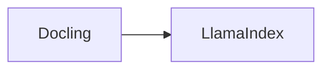

[🏠 Inicio](../README.md) · [🧪 Todas las recetas](README.md)

# 📎 RAG sobre tus documentos

> **Objetivo:** Preguntarle a tus PDFs, manuales y bases de conocimiento con respuestas citadas.

## Empieza con una versión pequeña

Propuesta editorial; no es una integración ejecutada ni una lista completa de dependencias.

**Piezas iniciales:** [Docling](../fichas/docling.md), [LlamaIndex](../fichas/llama-index.md)

**Prepara:** Un PDF de dos páginas y tres preguntas con respuesta conocida

**Primera prueba propuesta:** Extrae el texto y crea una consulta mínima con un proveedor elegido

**Qué comprobar:** Las respuestas pueden contrastarse con fragmentos del documento

El modelo y los embeddings necesitan configuración propia; almacenamiento vectorial, evaluación y trazas se añaden después

## Orden propuesto para preparar las piezas

## 🧩 Piezas

| # | Repo | Papel en la receta | ⭐ | Instalación |
|---:|---|---|---:|---|
| 1 | [Docling](../fichas/docling.md) | Extrae texto, tablas y estructura de los documentos | 70.6k | Abre las instrucciones originales enlazadas y elige tu sistema operativo y una sola rut… |
| 2 | [LlamaIndex](../fichas/llama-index.md) | Fragmenta, indexa y recupera; orquesta las consultas | 52.9k | Abre las instrucciones originales enlazadas y elige tu sistema operativo y una sola rut… |
| 3 | [Qdrant](../fichas/qdrant.md) | Base vectorial para los embeddings | 35.6k | Abre las instrucciones originales enlazadas y elige tu sistema operativo y una sola rut… |
| 4 | [litellm](../fichas/litellm.md) | Acceso unificado al LLM (local o en la nube) | 63.3k | Abre las instrucciones originales enlazadas y elige tu sistema operativo y una sola rut… |
| 5 | [Ragas](../fichas/ragas.md) | Evalúa la calidad de recuperación y respuesta | 16.3k | Abre las instrucciones originales enlazadas y elige tu sistema operativo y una sola rut… |
| 6 | [langfuse](../fichas/langfuse.md) | Trazas y costos en producción | 37.4k | Abre las instrucciones originales enlazadas y elige tu sistema operativo y una sola rut… |

## 🔌 Cómo se conecta

Docling convierte los documentos en Markdown estructurado; LlamaIndex los fragmenta, genera embeddings y los guarda en Qdrant; en cada pregunta recupera los fragmentos relevantes y llama al modelo vía LiteLLM. Ragas mide si la respuesta usa bien el contexto y Langfuse registra cada consulta. Si prefieres una plataforma con UI, RAGFlow o AnythingLLM cubren el flujo completo.

## 🚫 Cuándo NO usar esta receta

Si tienes pocos documentos y cortos, pegarlos en el contexto del modelo es más simple. Si las preguntas cruzan muchas entidades, mira GraphRAG o LightRAG.

## 🔁 Variantes

- En lugar de [Docling](../fichas/docling.md): [Marker](../fichas/marker.md), [MinerU](../fichas/mineru.md), [Unstructured](../fichas/unstructured.md)
- En lugar de [LlamaIndex](../fichas/llama-index.md): [Haystack](../fichas/haystack.md), [langchain](../fichas/langchain.md)
- En lugar de [Qdrant](../fichas/qdrant.md): [Milvus](../fichas/milvus.md), [Chroma](../fichas/chroma.md), [pgvector](../fichas/pgvector.md)
- En lugar de [Ragas](../fichas/ragas.md): [DeepEval](../fichas/deepeval.md), [promptfoo](../fichas/promptfoo.md)
- En lugar de [langfuse](../fichas/langfuse.md): [Phoenix](../fichas/phoenix.md), [Opik](../fichas/opik.md), [MLflow](../fichas/mlflow.md)

---

Generado por `uv run repo-intelligence guide build` desde `INDICE_IA.json` + `INDICE_IA.detalle.json`. No edites este archivo a mano. Datos de GitHub verificados el 2026-11-14.
