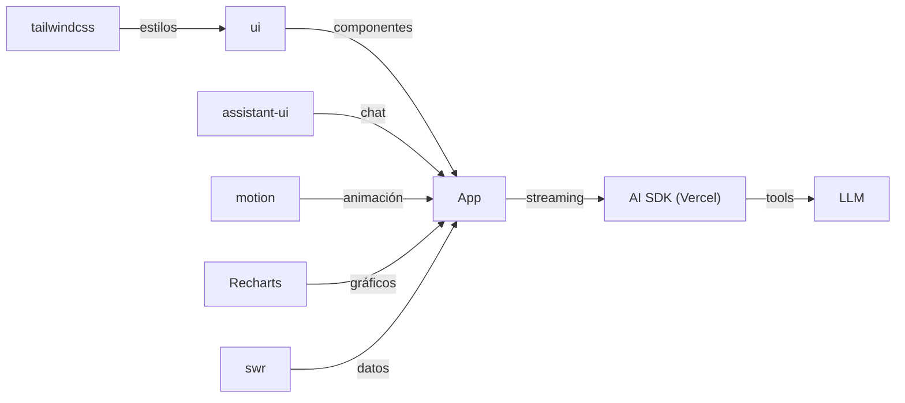

[🏠 Inicio](../README.md) · [🧪 Todas las recetas](README.md)

# 🌐 Web app moderna con IA

> **Objetivo:** Construir un frontend pulido con chat o funciones de IA integradas.

## 🗺️ Cómo fluye

## 🧩 Piezas

| # | Repo | Papel en la receta | ⭐ | Instalación |
|---:|---|---|---:|---|
| 1 | [ui](../fichas/ui.md) | Componentes accesibles que copias a tu código (shadcn/ui) | 128k | `npx shadcn@latest init` |
| 2 | [tailwindcss](../fichas/tailwindcss.md) | Estilos utilitarios | 98.7k | `npm i tailwindcss` |
| 3 | [AI SDK (Vercel)](../fichas/vercel-ai.md) | AI SDK: streaming, tools y llamadas a cualquier LLM | 27.9k | `npm i ai` |
| 4 | [assistant-ui](../fichas/assistant-ui.md) | Componentes de chat listos para conectar al AI SDK | 13k | `npx assistant-ui@latest init` |
| 5 | [motion](../fichas/motion.md) | Animaciones e interacciones | 35k | `npm i motion` |
| 6 | [Recharts](../fichas/recharts.md) | Gráficos para dashboards | 27.7k | `npm i recharts` |
| 7 | [swr](../fichas/swr.md) | Fetching y caché de datos en React | 32.5k | `npm i swr` |

## 🔌 Cómo se conecta

shadcn/ui y Tailwind dan la base visual; el AI SDK de Vercel resuelve streaming, tool calling y proveedores; assistant-ui aporta la interfaz de chat; Motion anima y Recharts dibuja datos; SWR gestiona el fetching. Para diseñar antes de codificar, prueba Open Design o Penpot.

## 🚫 Cuándo NO usar esta receta

Si es una landing estática, Tailwind y un par de componentes bastan. Si es un dashboard interno de datos, Streamlit o Superset son más rápidos.

## 🔁 Variantes

- En lugar de [ui](../fichas/ui.md): [Material UI](../fichas/mui.md), [Ant Design](../fichas/ant-design.md), [daisyUI](../fichas/daisyui.md)
- En lugar de [AI SDK (Vercel)](../fichas/vercel-ai.md): [LangGraph.js](../fichas/langgraphjs.md), [Mastra](../fichas/mastra.md)
- En lugar de [assistant-ui](../fichas/assistant-ui.md): [CopilotKit](../fichas/copilotkit.md)
- En lugar de [motion](../fichas/motion.md): [Anime.js](../fichas/animejs.md)
- En lugar de [Recharts](../fichas/recharts.md): [Chart.js](../fichas/chart-js.md), [echarts](../fichas/echarts.md)

---

Generado por `uv run repo-intelligence guide build` desde `INDICE_IA.json` + `INDICE_IA.detalle.json`. No edites este archivo a mano. Datos de GitHub verificados el 2026-11-05.
