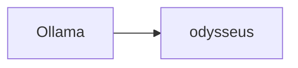

[🏠 Inicio](../README.md) · [🧪 Todas las recetas](README.md)

# 🏠 Workspace privado local soberano

> **Objetivo:** Preparar chat, documentos y memoria con rutas locales, comprobando por separado modelos, herramientas y conexiones externas.

## Empieza con una versión pequeña

Propuesta editorial; no es una integración ejecutada ni una lista completa de dependencias.

**Piezas iniciales:** [Ollama](../fichas/ollama.md), [odysseus](../fichas/odysseus.md)

**Prepara:** Un modelo que quepa en tu equipo y un archivo de prueba

**Primera prueba propuesta:** Conecta el motor local al espacio de trabajo y prueba una conversación

**Qué comprobar:** Identificas el endpoint del modelo y puedes revisar qué conexiones externas siguen activas

Configura y comprueba también embeddings, herramientas, memoria y búsqueda; local no garantiza ausencia de comunicaciones externas

## Orden propuesto para preparar las piezas

## 🧩 Piezas

| # | Repo | Papel en la receta | ⭐ | Instalación |
|---:|---|---|---:|---|
| 1 | [Ollama](../fichas/ollama.md) | Corre los modelos abiertos en local | 187k | `pip install ollama` |
| 2 | [odysseus](../fichas/odysseus.md) | Workspace todo-en-uno: chat, documentos y tareas | 95.6k | Abre las instrucciones originales enlazadas y elige tu sistema operativo y una sola rut… |
| 3 | [open-notebook](../fichas/open-notebook.md) | Cuaderno de investigación con RAG sobre tus fuentes | 42k | `docker compose up -d` |
| 4 | [mem0](../fichas/mem0.md) | Memoria persistente entre sesiones | 69k | Abre las instrucciones originales enlazadas y elige tu sistema operativo y una sola rut… |
| 5 | [SearXNG](../fichas/searxng.md) | Búsqueda web privada cuando hace falta | 39.6k | Ver README oficial (sin comando literal documentado). Abre la guía original enlazada y… |

## 🔌 Cómo se conecta

Ollama sirve modelos en tu equipo. Conecta una interfaz compatible y prueba primero el chat. Después evalúa documentos, memoria y búsqueda; cada componente requiere su propia configuración y puede abrir conexiones externas.

## 🚫 Cuándo NO usar esta receta

Si tu equipo no puede correr modelos (poca RAM o sin GPU), apunta las mismas apps a una API comercial vía LiteLLM. Si la privacidad no es un requisito, un SaaS es más simple.

## 🔁 Variantes

- En lugar de [Ollama](../fichas/ollama.md): [llama.cpp](../fichas/llama-cpp.md), [LocalAI](../fichas/localai.md), [llamafile](../fichas/llamafile.md)
- En lugar de [open-notebook](../fichas/open-notebook.md): [DeepTutor](../fichas/deeptutor.md), [SurfSense](../fichas/surfsense.md)
- En lugar de [mem0](../fichas/mem0.md): [Letta](../fichas/letta.md), [cognee](../fichas/cognee.md), [supermemory](../fichas/supermemory.md)

---

Generado por `uv run repo-intelligence guide build` desde `INDICE_IA.json` + `INDICE_IA.detalle.json`. No edites este archivo a mano. Datos de GitHub verificados el 2026-11-14.
