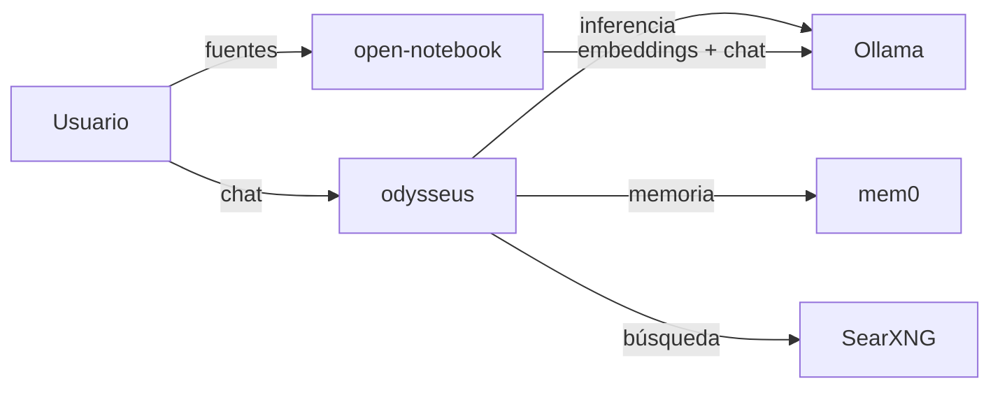

[🏠 Inicio](../README.md) · [🧪 Todas las recetas](README.md)

# 🏠 Workspace privado local soberano

> **Objetivo:** Tener chat, documentos y memoria de IA en tu propia máquina, sin enviar datos a terceros.

## 🗺️ Cómo fluye

## 🧩 Piezas

| # | Repo | Papel en la receta | ⭐ | Instalación |
|---:|---|---|---:|---|
| 1 | [Ollama](../fichas/ollama.md) | Corre los modelos abiertos en local | 187k | `curl -fsSL https://ollama.com/install.sh \| sh` |
| 2 | [odysseus](../fichas/odysseus.md) | Workspace todo-en-uno: chat, documentos y tareas | 95.5k | `docker compose` |
| 3 | [open-notebook](../fichas/open-notebook.md) | Cuaderno de investigación con RAG sobre tus fuentes | 41.8k | `docker` (imagen oficial) o `pip` más Ollama para los modelos locales. Requiere Ollama… |
| 4 | [mem0](../fichas/mem0.md) | Memoria persistente entre sesiones | 68.7k | `pip install mem0ai` |
| 5 | [SearXNG](../fichas/searxng.md) | Búsqueda web privada cuando hace falta | 39.4k | `docker run -d -p 8080:8080 searxng/searxng` |

## 🔌 Cómo se conecta

Ollama sirve los modelos en tu equipo con una API local. Odysseus centraliza chat, documentos y tareas; Open Notebook indexa tus fuentes para preguntarles como en NotebookLM; mem0 recuerda preferencias y hechos entre sesiones; SearXNG añade búsqueda web sin rastreo.

## 🚫 Cuándo NO usar esta receta

Si tu equipo no puede correr modelos (poca RAM o sin GPU), apunta las mismas apps a una API comercial vía LiteLLM. Si la privacidad no es un requisito, un SaaS es más simple.

## 🔁 Variantes

- En lugar de [Ollama](../fichas/ollama.md): [llama.cpp](../fichas/llama-cpp.md), [LocalAI](../fichas/localai.md), [llamafile](../fichas/llamafile.md)
- En lugar de [open-notebook](../fichas/open-notebook.md): [DeepTutor](../fichas/deeptutor.md), [SurfSense](../fichas/surfsense.md)
- En lugar de [mem0](../fichas/mem0.md): [Letta](../fichas/letta.md), [cognee](../fichas/cognee.md), [supermemory](../fichas/supermemory.md)

---

Generado por `uv run repo-intelligence guide build` desde `INDICE_IA.json` + `INDICE_IA.detalle.json`. No edites este archivo a mano. Datos de GitHub verificados el 2026-11-05.
